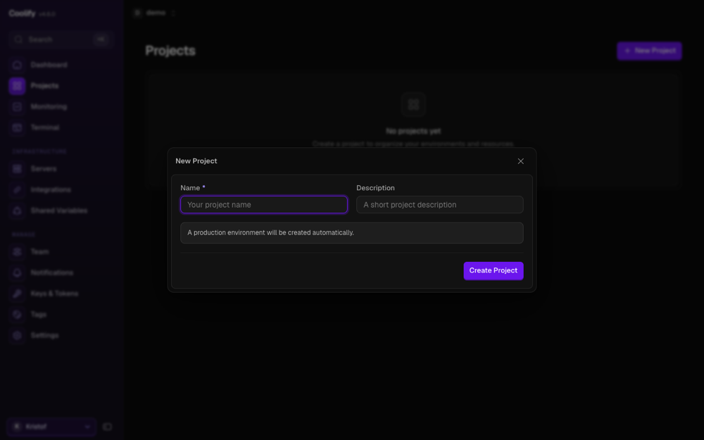
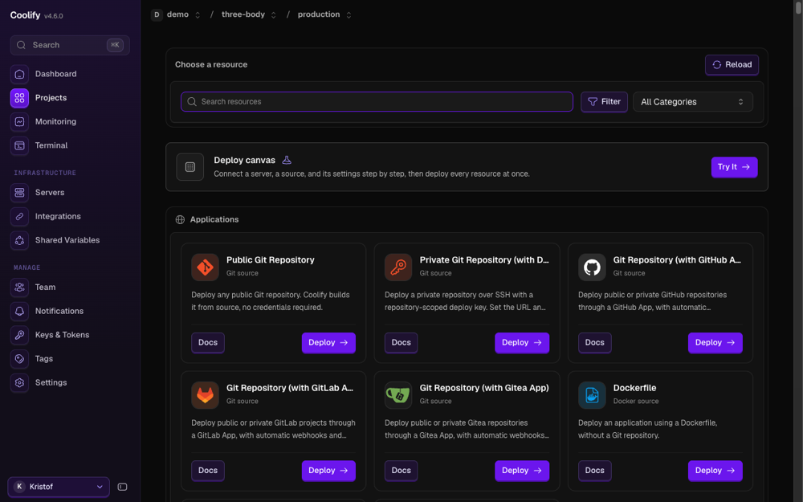
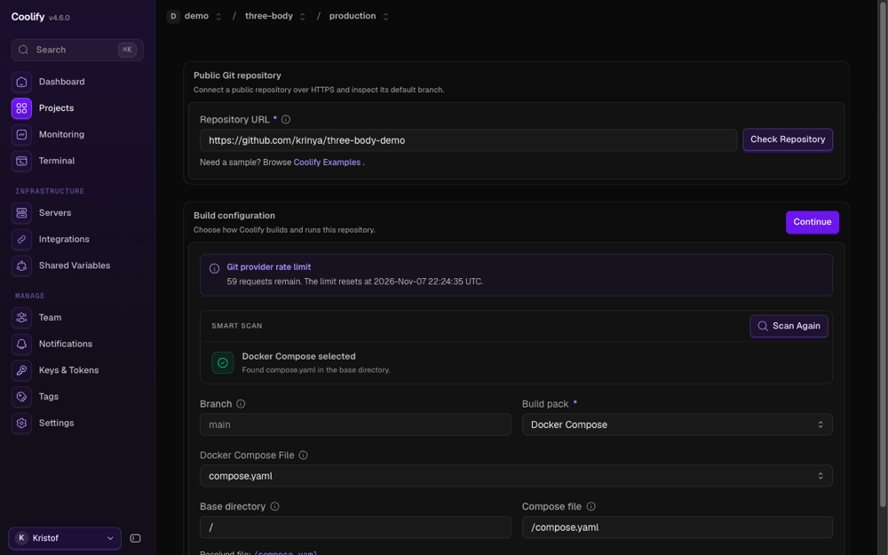
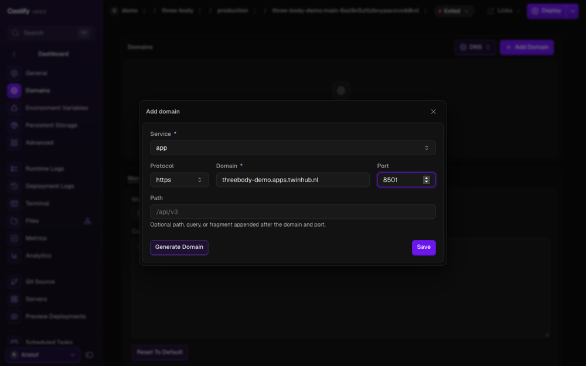
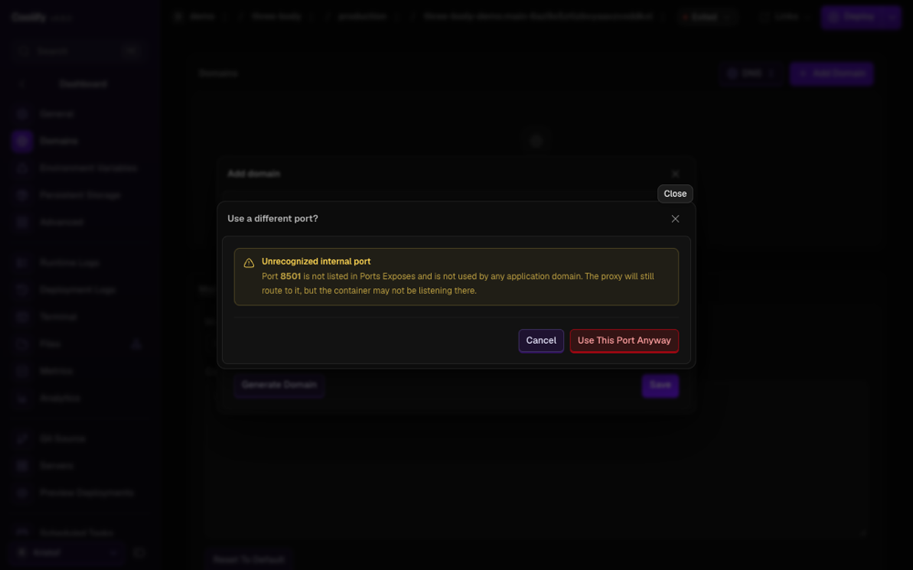
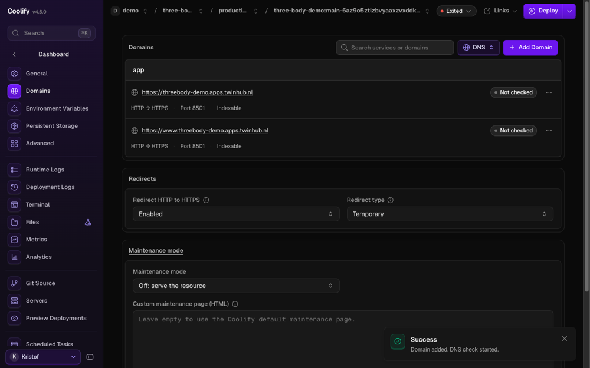
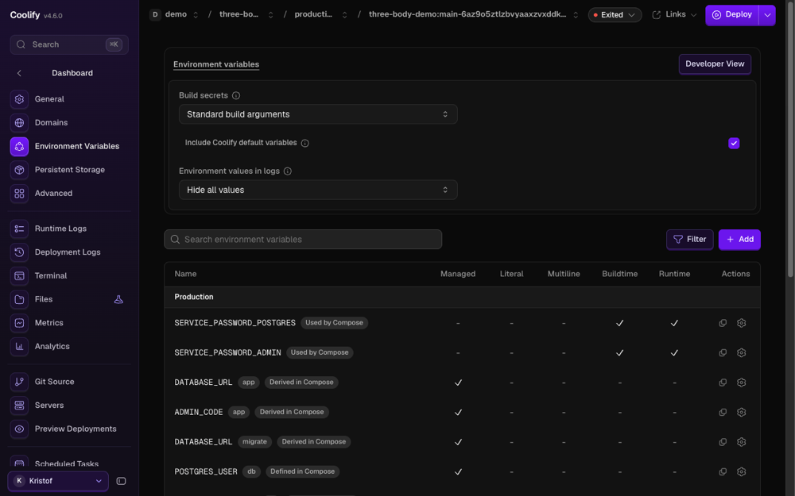
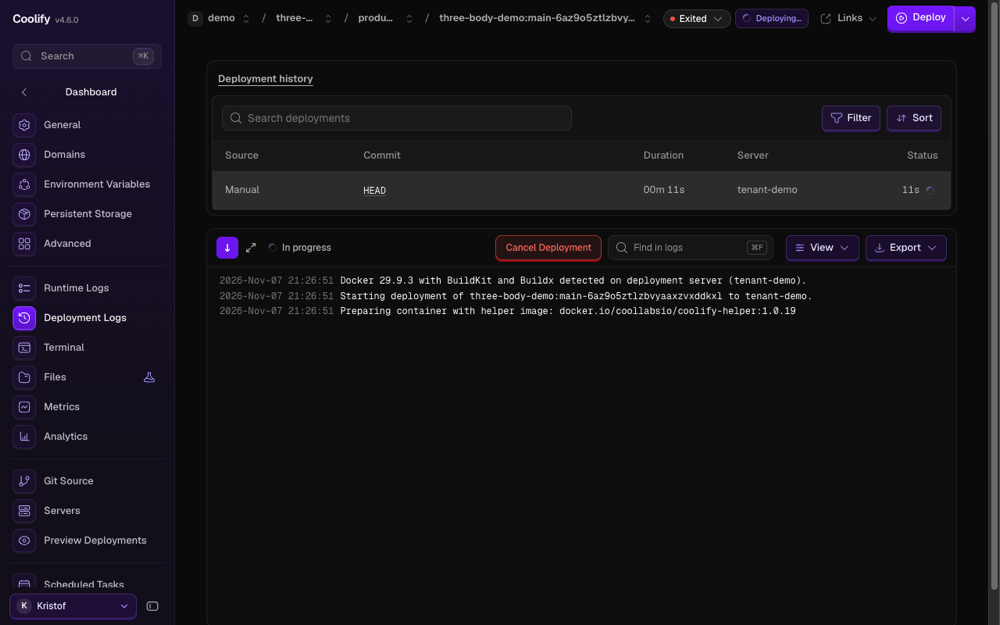
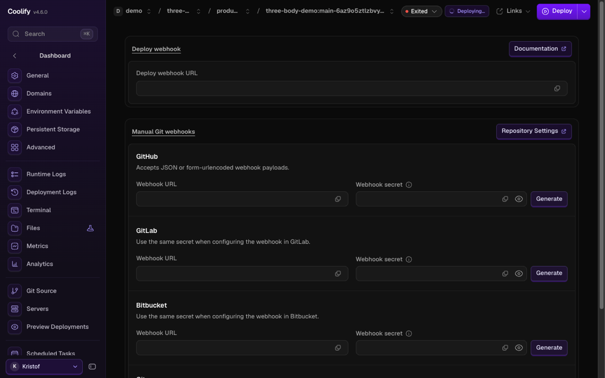
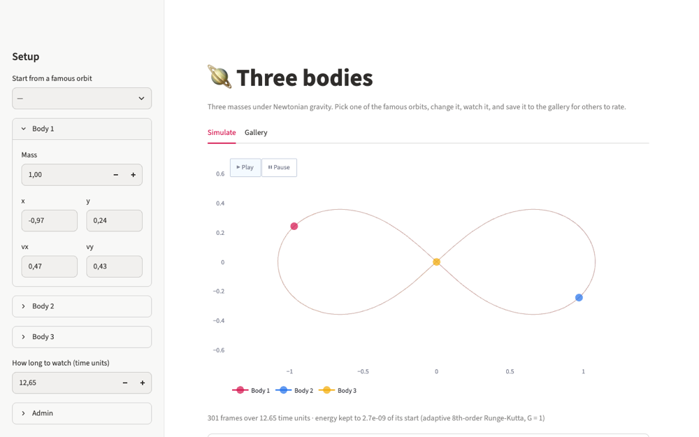

# Deploy this app on Coolify

You will fork this repository, point your [Coolify](https://coolify.io) team at the fork, and get
the app on a public HTTPS address that redeploys on every push to `main`. About fifteen minutes.

> Written for the HR DataLab's panel (<https://panel.apps.twinhub.nl>). Button names follow
> Coolify 4.x and can differ a little between versions.

## What you need

- A Coolify team with a server (a *tenant*). Your sponsor at the lab arranges it.
- A GitHub account.
- Your server's name (the *tenant*), from your sponsor. Your app's address ends in it:
  `https://<anything>-<tenant>.apps.twinhub.nl`, for example `https://threebody-myteam.apps.twinhub.nl`.

## What gets deployed

[`compose.yaml`](../compose.yaml) describes three services and Coolify runs them together:

| Service | Job |
| --- | --- |
| `app` | Streamlit on port 8501, the only service with a public address |
| `migrate` | runs once before `app`: creates the tables, then seeds the famous orbits, then exits |
| `db` | PostgreSQL 17 with a volume, so the gallery survives restarts and redeploys |

`app` and `migrate` are built from the [`Dockerfile`](../Dockerfile) in this repository; Coolify does
the build on your server. The two passwords are `${SERVICE_PASSWORD_POSTGRES}` and
`${SERVICE_PASSWORD_ADMIN}`: Coolify sees the `SERVICE_PASSWORD_` prefix, generates a value once and
fills it in. Nothing secret is in the repository, and you never type a password.

## Steps

Walked through in the panel on 2026-11-07 (Coolify 4.6.0) as a new team, `demo`, with its own
server; the names below are the panel's own, and the screenshots are from that walk.

1. **Fork** this repository on GitHub (**Fork**, top right). A fork is yours to push to.
2. In the panel: **Projects → New Project**, give it a name, **Create Project**.

   

3. The project opens on its `production` environment. Press **Add Resource**, then **Deploy** on
   the **Public Git Repository** card. (**Private Git Repository (with Deploy Key)** works for code
   you do not want to publish, but the panel says it has no automatic deploys; **Git Repository
   (with GitHub App)** needs a GitHub App the panel does not have yet.)

   

4. Paste the fork's URL and press **Check Repository**. Your team has one server, so the panel
   picks it without asking. Coolify finds `compose.yaml` and selects the **Docker Compose** build
   pack on branch `main` by itself. Press **Continue**.

   

5. Open **Domains → Add Domain**. Service `app`, protocol `https`, domain
   `threebody-myteam.apps.twinhub.nl` (without `https://`), port `8501`, **Save**.

   

   - Coolify warns *Unrecognized internal port*: 8501 is where Streamlit listens, so choose
     **Use This Port Anyway**.

     

   - Coolify also adds `www.threebody-myteam.apps.twinhub.nl`. That name does not resolve; remove
     it: its **⋯ → Delete**, untick *Also delete the DNS record*, **Continue → Remove Domain**.

     

6. There are no environment variables to set. **Environment Variables** lists
   `SERVICE_PASSWORD_POSTGRES` and `SERVICE_PASSWORD_ADMIN`, marked *Used by Compose*, generated by
   Coolify. The admin password is the code that lets you delete setups in the gallery.

   

7. Press **Deploy** (top right). **Deployment Logs** shows the image build on your server, `db`
   becoming healthy, `migrate` running and exiting, then `app` starting. The first build takes
   about five minutes; later ones reuse the cache.

   

8. **Automatic deploys.** Open **Webhooks → Manual Git webhooks → GitHub**. Copy the webhook URL
   and the secret (the copy icon; the eye shows it) into your fork's **Settings → Webhooks → Add
   webhook**, content type `application/json`, just the push event. If the page says it has unsaved
   changes, press **Save changes** first, or the secret it shows is not the one Coolify checks.
   **Generate** makes a new secret; paste that one into GitHub too.

   

9. Visit your address. The certificate is issued within a minute of the first visit, and the
   gallery already holds the sixteen famous orbits.

   

`verified 2026-11-07: steps 2–7 and 9 in the panel as team demo on its own server tenant-demo →
https://threebody-demo.apps.twinhub.nl answered 200 with a Let's Encrypt certificate and a seeded
gallery; step 8's webhook was not added for that copy (a push → deploy is verified on the demo
itself)`.

## The address: choosing it, changing it, your own domain

An app's address is `https://<app>-<tenant>.apps.twinhub.nl`. The `<tenant>` part is your team's
server and is fixed; the `<app>` part is yours to choose, and you can change it yourself. The lab's
front door sends every name that ends in `-<tenant>.apps.twinhub.nl` to your server, and the
wildcard DNS record `*.apps.twinhub.nl` makes every such name resolve, so a new name needs nothing
from the lab.

**Change the name**: on **Domains**, the name's **⋯ → Edit**, keep the port, save, and redeploy. The old name stops answering; your server's proxy fetches a certificate
for the new one on its own. Use **one name per service**: adding a second name beside the first did
not get routed in a test (cause not found), so replace rather than add.

`verified 2026-11-07: the demo's domain replaced by renametest-pilot.apps.twinhub.nl and redeployed
→ HTTP 200 with a Let's Encrypt certificate about 30 s after the deploy finished; the old name then
gave 503 until the domain was put back`.

**Your own domain** (`myapp.example.org`): point a `CNAME` at the pool's hostname (an `A` record for a
bare domain), ask your sponsor to add the name to your server's allowed names, then enter it as the
resource's domain. Names under `twinhub.nl` cannot be claimed this way, and a custom domain still
needs the lab until its tooling exists.

## Day to day

- **Change the app**: edit, push to `main`, Coolify rebuilds and redeploys.
- **Your data stays**: the gallery lives in the `db-data` volume. A redeploy replaces the containers,
  not the volume.
- **A schema change** is a new file in `migrations/versions/`. `migrate` applies it before the new
  `app` starts, on every deploy.
- **Roll back**: `git revert` the bad commit and push; Coolify builds the code as it was.
- **Every push redeploys**, documentation included, and the app is down for a few seconds while
  the new containers start.
- **Logs and shell**: per service, in the resource. `migrate` is a one-shot job, so its log is the
  place to look when a deploy stops before the app starts.

## Keep bad code from going live

Coolify deploys whatever lands on the branch; it does not wait for GitHub Actions. This repository's
[CI](../.github/workflows/ci.yml) runs format, lint, types and tests (against a real PostgreSQL) on
every push and pull request, so the habit that keeps the site safe is:

1. Work on a branch and open a pull request.
2. Merge only when CI is green.

If you want the server to be stricter, GitHub's **Settings → Branches** can require the check before
merging (private repositories need a paid plan for this).

## Use it for your own app

What this repository shows, and your app needs too:

- A `Dockerfile` that listens on one port and runs without root. Keep dependencies locked
  (`uv.lock`) so a rebuild gives the same app.
- A `compose.yaml` with `build: .` for your code, other services as ordinary images, and
  `${SERVICE_PASSWORD_*}` for any password.
- A one-shot service for migrations, with `depends_on: condition: service_completed_successfully`
  on the app. Mark it `coolify.proxy=false` so Coolify does not try to route to it.
- A healthcheck on the database and `condition: service_healthy` where something waits for it.

If your app is a single container with no database, skip Compose: choose **Dockerfile** as the build
pack, or let Coolify detect the language, and set the port in the resource.

## When something goes wrong

| You see | Check |
| --- | --- |
| Bad gateway | the domain's port is `8501`; `app` is running, not restarting |
| Deploy stops at `migrate` | its log; a failing migration keeps `app` from starting, by design |
| Build killed or very slow | your server ran out of memory during the build; ask your sponsor for more, or build the image in GitHub Actions and deploy it (below) |
| No certificate, or a name that does not open | the name resolves to the pool (`dig +short <address>`); wait a minute after the deploy and reload; the name must end in your server's `-<tenant>.apps.twinhub.nl` |
| A push did not deploy | the webhook's **Recent Deliveries** in GitHub; a failed one usually means the secret differs: save it in Coolify and paste it again (step 8) |

## Later: build in CI, deploy a pinned image

Building on your server is the simple route. The stricter one builds the image in GitHub Actions,
scans it, pushes it to a registry, and tells Coolify to run that exact image by digest, so nothing
that failed CI reaches the site and the server never builds. It is more setup (a registry package
the server can pull, a Coolify API token, two repository variables). An earlier version of this
repository did exactly that; see the git history before the commit "Coolify builds from GitHub".
